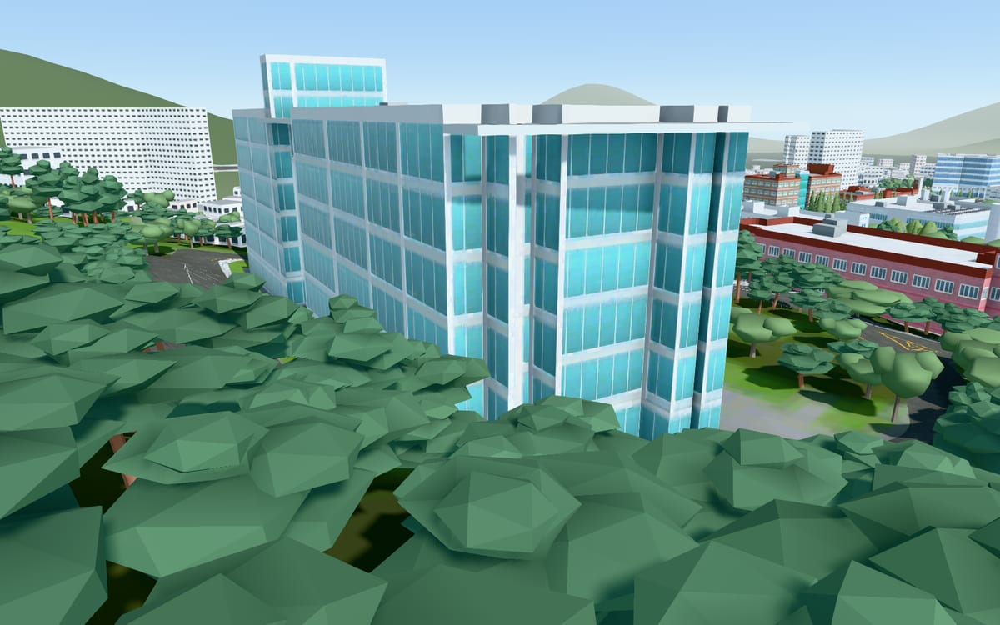

<div align="center">

# SCNU Digital Twin

국립순천대학교 캠퍼스를 3D로 옮기고 그 위에 날씨, 교통, 에너지 정보를 겹쳐 보는 대시보드입니다.


</div>

## 어떤 프로젝트인가

캠퍼스 하나를 통째로 화면에 띄워 놓고 지금 이 시각에 건물 그림자가 어디까지 오는지, 어느 길이 막히는지, 옥상에 태양광을 얹으면 하루에 얼마나 나오는지를 한 화면에서 봅니다. 모델은 공개 지리 데이터와 항공사진에서 스크립트로 만들었습니다. 손으로 모델링한 부분은 없습니다.

세 가지가 한 저장소에 들어 있습니다.

- 3D 캠퍼스 모델과 그 생성기. 지형, 건물 29동, 도로와 인도, 연석, 차선과 횡단보도, 수목 2,650그루, 가로등까지 `frontend/scripts/campus-model/`이 만들어 냅니다. 결과물은 `frontend/public/campus-v2.glb` 파일 하나입니다. 19 MB, 삼각형 약 100만 개.
- 대시보드. Three.js로 그리는 Main이 제품입니다. 로그인하면 계정 역할에 따라 학생 화면이나 관리자 대시보드가 열립니다. VWorld 지도 위에 올리는 VWorld 엔트리는 개발을 멈추고 빌드만 유지합니다.
- 뒤에서 숫자를 대 주는 Python 서비스. 기상청과 에어코리아 자료를 받아 건물별 미기후를 추정하는 `weather/`, 보행자와 차량을 따로 움직이는 교통 시뮬레이션 `backend/simulation/`, 정문 카메라에서 차량을 세는 `vision_api.py`.

화면에 나오는 숫자 중 상당수는 계측값이 아니라 추정값입니다. 건물 높이, 재질, 일사량, 전력 수요가 그렇습니다. 화면마다 `추정` 표시를 달아 두었고 어떤 데이터를 어디서 가져와 어떻게 쓰기로 했는지는 [`docs/data-licences.md`](docs/data-licences.md)에 적었습니다.

<table>
<tr>
<td width="50%"></td>
<td width="50%"></td>
</tr>
<tr>
<td align="center"><sub>공과대학 3호관(D4). 층별, 호실별로 들어가 볼 수 있는 건물입니다.</sub></td>
<td align="center"><sub>학생회관 앞 광장, 오후 5시. 태양 위치와 그림자는 시각 슬라이더를 따라 움직입니다.</sub></td>
</tr>
</table>

## 구성

| 폴더 | 하는 일 | 포트 |
|---|---|---|
| `frontend/` | 대시보드(Main, 동결한 VWorld)와 캠퍼스 모델 생성기 | 5173 |
| `weather/` | 기상, 미기후, 에너지(태양광) API | 8000 |
| `vision_api.py`, `car_vision_model/` | YOLO 차량 계수. 대시보드용 엔드포인트와 별도 데모 | 8001, 8003 |
| `backend/simulation/` | 교통 시뮬레이션 API와 WebSocket | 8002 |
| `common/data/` | 건물, 도로, 교차로 ID와 지오메트리. 모든 서비스가 같은 `BLD_*` ID를 씁니다 | |
| `common/campus_auth.py` | 계정과 로그인 토큰. 기상 API와 교통 시뮬레이션 API가 같이 씁니다 | |
| `TrafficSafety/` | 안전 신고 OCR/NLP 실험(Streamlit). 대시보드와 따로 돕니다 | |
| `docs/` | 정적 데모 페이지, 테스트 증빙, 데이터 라이선스 기록 | |

폴더마다 `README.md`나 `AGENTS.md`가 있습니다. 모델 생성기를 손대려면 [`frontend/scripts/campus-model/README.md`](frontend/scripts/campus-model/README.md)부터, 교통망은 [`backend/simulation/README.md`](backend/simulation/README.md)부터 읽으면 됩니다.

## 시작하기

Python 3.11 이상과 bun 1.1 이상이 필요합니다. 명령은 전부 저장소 루트에서 실행합니다.

```bash
python3 -m venv .venv
.venv/bin/python -m pip install -r weather/requirements.txt -r backend/simulation/requirements.txt -r car_vision_model/requirements_server.txt
bun install --cwd frontend
cp weather/.env.example weather/.env
cp frontend/.env.example frontend/.env
```

`weather/.env`에 기상청과 에어코리아 키를, `frontend/.env`에 VWorld 키(VWorld 모드를 쓸 때만)를 넣습니다. 키는 커밋하지 않습니다.

서비스는 터미널을 하나씩 열어 띄웁니다.

```bash
.venv/bin/python -m uvicorn api.app:app --app-dir weather --host 127.0.0.1 --port 8000
.venv/bin/python -m uvicorn simulation.main:app --app-dir backend --host 127.0.0.1 --port 8002
bun run --cwd frontend dev:main
```

브라우저에서 `http://127.0.0.1:5173`을 열면 로그인 화면이 먼저 뜹니다. `게스트 · 학생 모드`를 누르면 학생 화면이, `게스트 · 관리자 모드`를 누르면 기능이 다 있는 관리자 대시보드가 열립니다. 계정으로도 로그인합니다. 시제품용 계정은 학생 `20239901`과 관리자 `admin`이고 비밀번호는 둘 다 `12341234`입니다. 비밀번호는 8자리만 받습니다.

읽기는 누구에게나 열려 있고 설치 계획 저장이나 시뮬레이션 제어 같은 쓰기는 서버가 관리자 토큰을 확인합니다. 서비스에 올리기 전에는 `SCNU_AUTH_GUEST_ENABLED=0`으로 게스트 로그인을 끄고 `common/campus_auth.py`의 계정을 바꿉니다.

기상 API가 없어도 게스트 단추로 들어가면 지도와 건물 선택은 됩니다. 패널의 날씨 칸만 "기상 갱신 없음"으로 뜹니다. VWorld 모드는 `dev:vworld`로 띄우고 `/index-vworld.html`로 들어갑니다. Vision API(8001)는 YOLO 가중치와 카메라가 있을 때만 필요합니다.

카메라 제스처(두 대시보드 공통): 트랙패드는 핀치 확대·축소, 두 손가락 가로 쓸기 회전, Option(Alt)+두 손가락 세로 쓸기 기울이기이고, 터치 화면은 한 손가락 끌기 회전, 두 손가락 핀치 확대·끌기 이동·비틀기 회전입니다(`frontend/src/camera/cameraGestures.mjs`).

Windows 명령, 포트 바꾸기, 휴대폰에서 열기, 태양광 개발용 SQLite 설정은 아래 접힌 절에 있습니다.

### 자주 쓰는 명령

| 할 일 | 명령 |
|---|---|
| 프런트엔드 테스트 | `bun run --cwd frontend test` |
| Python 테스트 | `.venv/bin/python -m pytest` |
| 두 엔트리 빌드 | `bun run --cwd frontend build && bun run --cwd frontend build:vworld` |
| 캠퍼스 GLB 다시 만들기 | `bun run --cwd frontend model:build` |
| 건물과 지면 AO 다시 굽기 | `bun frontend/scripts/campus-model/bake/bake-ao.mjs`, 지면은 `--planar` |
| 교통망 다시 만들기 | `bun run --cwd frontend network:build` |
| 예전 모델과 비교 | 대시보드를 `?model=uni`로 열기 |

프런트엔드 테스트는 node 단위 테스트, vitest, 정적 검사 세 층을 한 번에 돌립니다. 모델을 고쳤으면 `model:build`로 GLB를 다시 만들어 같이 커밋합니다. 생성기가 지오메트리를 바꿨을 때는 AO도 다시 굽습니다.

## 함께 일하는 방법

`dev`가 메인 브랜치입니다. `main`에는 배포할 소스만 올립니다.

1. `dev`에서 `feature/<작업명>` 브랜치를 땁니다.
2. 작업하고 커밋합니다. 커밋 메시지는 `fix:`, `feat:`, `build:` 같은 접두어 뒤에 한국어로 무엇을 왜 바꿨는지 씁니다.
3. 올리기 전에 테스트를 돌립니다. 모델을 건드렸으면 GLB를 다시 만듭니다.
4. 원격에 올리고 `dev`로 PR을 엽니다. 리뷰가 끝나면 머지하고 브랜치를 지웁니다.

```bash
git checkout dev && git pull origin dev
git checkout -b feature/<작업명>
# 작업, 커밋
git push -u origin feature/<작업명>
```

한 파일을 여러 명이 동시에 고치면 충돌이 납니다. 작업 단위를 컴포넌트나 모듈로 나누고 작업이 길어지면 원격 `dev`를 수시로 자기 브랜치에 합칩니다. 충돌은 PR 전에 로컬에서 풉니다.

제품은 Main입니다. VWorld는 기능 개발과 검수를 멈추지만 패널이나 데이터 흐름 같은 공용 코드를 바꾸면 `build:vworld`는 통과해야 합니다. 이 저장소는 비공개이지만 사업단 증빙이 필요하면 공개될 수 있으니 민감한 값은 처음부터 넣지 않습니다.

---

<details>
<summary><b>상세 설치와 실행</b>. Windows 명령, 포트 바꾸기, 휴대폰에서 보기, 문제 해결</summary>

### 준비물

- Python 3.11 이상
- bun 1.1 이상
- ffmpeg. 녹화 영상을 비전 입력으로 쓸 때만 필요합니다.

아래에는 macOS/Linux용 bash 블록과 Windows용 PowerShell 블록이 짝으로 있습니다. 가상환경은 활성화하지 않고 인터프리터 경로로 바로 부릅니다.

### 설치

저장소 루트에 `.venv` 하나를 만들고 세 서비스의 의존성을 함께 설치합니다.

```bash
python3 -m venv .venv && .venv/bin/python -m pip install -r weather/requirements.txt -r backend/simulation/requirements.txt -r car_vision_model/requirements_server.txt
```

```powershell
py -m venv .venv; .venv\Scripts\python.exe -m pip install -r weather\requirements.txt -r backend\simulation\requirements.txt -r car_vision_model\requirements_server.txt
```

환경 파일은 예시를 복사한 뒤 값을 채웁니다.

```bash
cp weather/.env.example weather/.env && cp frontend/.env.example frontend/.env
```

```powershell
cp weather\.env.example weather\.env; cp frontend\.env.example frontend\.env
```

- `weather/.env`: 기상청(KMA), 에어코리아 키
- `frontend/.env`: `VITE_VWORLD_API_KEY`(VWorld 모드), `VITE_API_URL`, `VITE_VISION_API_URL`, `VITE_SIMULATION_API_URL`, `VITE_SIMULATION_WS_URL`

### 실행

#### Weather API (`127.0.0.1:8000`)

```bash
.venv/bin/python -m uvicorn api.app:app --app-dir weather --host 127.0.0.1 --port 8000
```

```powershell
.venv\Scripts\python.exe -m uvicorn api.app:app --app-dir weather --host 127.0.0.1 --port 8000
```

상태 확인은 `http://127.0.0.1:8000/health`, API 문서는 `http://127.0.0.1:8000/docs`입니다.

#### Vision API (`127.0.0.1:8001`)

`--source 0`은 기본 카메라입니다. 영상 파일 경로나 스트림 URL을 넣어도 됩니다. YOLO 가중치는 저장소에 없으니 따로 받아 `--model <경로>`로 넘깁니다.

```bash
.venv/bin/python vision_api.py --source 0 --port 8001
```

```powershell
.venv\Scripts\python.exe vision_api.py --source 0 --port 8001
```

상태 확인은 `http://127.0.0.1:8001/api/traffic`입니다.

#### 교통 시뮬레이션 API (`127.0.0.1:8002`)

```bash
.venv/bin/python -m uvicorn simulation.main:app --app-dir backend --host 127.0.0.1 --port 8002
```

```powershell
.venv\Scripts\python.exe -m uvicorn simulation.main:app --app-dir backend --host 127.0.0.1 --port 8002
```

상태 확인은 `http://127.0.0.1:8002/health`입니다. 보행자와 차량을 분리한 교통망을 다시 만들려면 `bun run --cwd frontend network:build`를 실행합니다. 자세한 내용은 `backend/simulation/README.md`의 "보행/차량 분리 교통망"에 있습니다.

#### Frontend (`127.0.0.1:5173`)

Main(Three.js)과 VWorld는 별개 엔트리입니다.

```bash
bun run --cwd frontend dev:main
bun run --cwd frontend dev:vworld
```

Main은 `http://127.0.0.1:5173`, VWorld는 `http://127.0.0.1:5173/index-vworld.html`에서 엽니다. 건물을 누르면 `BLD_*` 상세가 열리고 공과대학 3호관(D4)은 층과 호실까지 들어갑니다.

### 다른 포트로 실행

백엔드는 `--port`만 바꾸고 프런트엔드에는 같은 포트를 가리키는 `VITE_*` 값을 줍니다. Vite 포트는 `--port`로 바꿉니다.

```bash
export VITE_API_URL=http://127.0.0.1:18000 && export VITE_VISION_API_URL=http://127.0.0.1:18001 && export VITE_SIMULATION_API_URL=http://127.0.0.1:18002 && export VITE_SIMULATION_WS_URL=ws://127.0.0.1:18002/ws/simulation && cd frontend && bun run dev:main -- --port 15173
```

```powershell
$env:VITE_API_URL="http://127.0.0.1:18000"; $env:VITE_VISION_API_URL="http://127.0.0.1:18001"; $env:VITE_SIMULATION_API_URL="http://127.0.0.1:18002"; $env:VITE_SIMULATION_WS_URL="ws://127.0.0.1:18002/ws/simulation"; cd frontend; bun run dev:main -- --port 15173
```

### 테스트와 빌드

```bash
bun run --cwd frontend test
.venv/bin/python -m pytest
bun run --cwd frontend build && bun run --cwd frontend build:vworld
```

```powershell
bun run --cwd frontend test
.venv\Scripts\python.exe -m pytest
bun run --cwd frontend build; bun run --cwd frontend build:vworld
```

빌드는 두 엔트리 모두 통과해야 합니다.

### 휴대폰에서 보기

PC와 휴대폰이 같은 Wi-Fi에 있어야 합니다. 백엔드는 `--host 0.0.0.0`으로 띄우고 프런트엔드는 PC의 LAN IP를 가리키게 합니다. `<LAN IP>`는 PC 주소(예: 192.168.0.10)로 바꿉니다.

```bash
.venv/bin/python -m uvicorn api.app:app --app-dir weather --host 0.0.0.0 --port 8000
.venv/bin/python -m uvicorn simulation.main:app --app-dir backend --host 0.0.0.0 --port 8002
export VITE_API_URL="http://<LAN IP>:8000" && export VITE_VISION_API_URL="http://<LAN IP>:8001" && export VITE_SIMULATION_API_URL="http://<LAN IP>:8002" && export VITE_SIMULATION_WS_URL="ws://<LAN IP>:8002/ws/simulation" && cd frontend && bun run dev:main -- --host 0.0.0.0
```

```powershell
.venv\Scripts\python.exe -m uvicorn api.app:app --app-dir weather --host 0.0.0.0 --port 8000
.venv\Scripts\python.exe -m uvicorn simulation.main:app --app-dir backend --host 0.0.0.0 --port 8002
$env:VITE_API_URL="http://<LAN IP>:8000"; $env:VITE_VISION_API_URL="http://<LAN IP>:8001"; $env:VITE_SIMULATION_API_URL="http://<LAN IP>:8002"; $env:VITE_SIMULATION_WS_URL="ws://<LAN IP>:8002/ws/simulation"; cd frontend; bun run dev:main -- --host 0.0.0.0
```

Vision API는 기본값이 `--host 0.0.0.0`이라 그대로 둡니다. 휴대폰 브라우저에서 `http://<LAN IP>:5173`을 엽니다. VWorld 모드는 API 키에 그 호스트(LAN IP)가 등록돼 있어야 지도 인증을 통과합니다. 등록이 안 됐으면 Main 모드로 봅니다.

### 문제 해결

- 날씨 패널이 늦거나 비어 있다: 기상청이나 에어코리아 호출이 느리거나 실패한 경우입니다. 이전 응답이 있으면 캐시한 값을 보여 주고 없으면 API가 503과 안내 메시지를 돌려줍니다. 지도와 건물 팝업은 그대로 동작합니다.
- VWorld 지도가 안 뜬다: `frontend/.env`의 `VITE_VWORLD_API_KEY`가 비었거나, 접속한 호스트가 키에 등록되지 않은 경우입니다.
- Vision API가 모델을 못 찾는다: YOLO 가중치는 저장소에 없습니다(gitignore). 따로 받아 두고 `--model`로 경로를 넘깁니다. 첫 실행은 모델과 카메라를 여느라 느립니다.
- 자동차 비전 데모(`car_vision_model/`)는 대시보드와 별개라서 8003 포트를 씁니다. 8001의 대시보드 Vision API와 겹치지 않게 합니다.

</details>

<details>
<summary><b>태양광과 에너지 개발 환경</b>. SQLite seed와 reset, 계산식, 확인 경로</summary>

### 개발용 데이터베이스

실행마다 다른 SQLite 파일을 씁니다. FastAPI가 처음 접근할 때 스키마와 결정적 캠퍼스 seed(D1-D4, C1, 옥상, 시간표, 기본 설치 시나리오)를 만듭니다. 아래는 Windows PowerShell 기준입니다.

```powershell
$RunId = [guid]::NewGuid().ToString('N')
$EnergyDbParent = (Join-Path $env:TEMP "campus-energy-$RunId")
New-Item -ItemType Directory -Path $EnergyDbParent -ErrorAction Stop | Out-Null
$EnergyDbPath = (Join-Path $EnergyDbParent 'energy.sqlite3')
$env:WEATHER_ENERGY_DB = $EnergyDbPath
.venv\Scripts\python.exe -m uvicorn api.app:app --app-dir weather --host 127.0.0.1 --port 8000
```

두 번째 PowerShell에서 Vite를 띄웁니다. 프런트엔드는 기본으로 `http://127.0.0.1:8000`의 FastAPI를 씁니다.

```powershell
cd frontend; bun run dev:main -- --host 127.0.0.1 --port 5173 --strictPort
```

### seed와 reset

- Seed(비파괴): `WEATHER_ENERGY_DB`가 가리키는 파일에 빠진 스키마와 내장 fixture만 추가합니다. `INSERT OR IGNORE`라서 기존 사용자 시나리오, 배열, 계산 결과를 지우거나 덮어쓰지 않습니다.

  ```powershell
  .venv\Scripts\python.exe -c "from weather.energy.persistence import Database; import os; Database(os.environ['WEATHER_ENERGY_DB']).initialize(); print(os.environ['WEATHER_ENERGY_DB'])"
  ```

- Reset(권장, 비파괴): 기존 파일을 지우지 말고 새 고유 경로로 바꾼 뒤 위 seed 명령을 실행합니다. 이전 데이터베이스와 사용자 시나리오는 그대로 남습니다.

  ```powershell
  $EnergyDbParent = (Join-Path $env:TEMP ("campus-energy-{0}" -f [guid]::NewGuid().ToString('N')))
  New-Item -ItemType Directory -Path $EnergyDbParent -ErrorAction Stop | Out-Null
  $EnergyDbPath = (Join-Path $EnergyDbParent 'energy.sqlite3')
  $env:WEATHER_ENERGY_DB = $EnergyDbPath
  .venv\Scripts\python.exe -c "from weather.energy.persistence import Database; import os; Database(os.environ['WEATHER_ENERGY_DB']).initialize(); print(os.environ['WEATHER_ENERGY_DB'])"
  ```

- 시나리오 하나만 지우기: 사용자 데이터 삭제는 실행 중인 API에 정확한 시나리오 ID를 줄 때만 합니다. 와일드카드나 전체 reset 명령은 없습니다.

  ```powershell
  Invoke-WebRequest -Method Delete -Uri 'http://127.0.0.1:8000/energy/scenarios/EXACT_SCENARIO_ID'
  ```

데이터베이스 파일을 지우거나 공유 DB를 reset하지 않습니다. 개발이나 QA가 끝나 지워야 하면 자기가 만든 고유 경로인지 먼저 확인합니다.

### 가정과 계산식

소비량은 전부 계측값이 아니라 15분 단위 가상 예측입니다. 기상 preset은 시나리오용 추정이지 공학 보정값이 아닙니다.

- 기본 대기 부하(kW): 강의실 0.20, 컴퓨터실 0.80, 실험실 1.00, 교수실 0.40, 서버실 6.00.
- 점유 시 조명(kW): 소/중/대 0.60/1.00/1.50. 일반 plug 부하(kW): 강의실 0.40, 컴퓨터실 0.80, 실험실 2.00, 교수실 0.80.
- 컴퓨터 0.15 kW/대, 대형 화면 0.30 kW, 점유 HVAC 2.50 kW/대, 서버 HVAC 상시 1.25 kW/대.
- 모듈: 1.05 m x 2.10 m, 효율 20%, 정격 441 Wp, 패널 간격 0.02 m. 옥상 가장자리 0.50 m, 장애물 1.00 m 이격.
- 발전량: `용량(kWp) x 경사면 일사량(kWh/m2) x 온도계수 x (1 - 시스템손실) x 음영계수`. 기본 시스템 손실은 10%이고 각 곱셈 계수는 0..1로 제한합니다.
- 직접사용량 `min(발전, 수요)`, 계통수전 `max(수요 - 발전, 0)`, 잉여 `max(발전 - 수요, 0)`, 자급률 `직접사용 / 수요`, 태양광 활용률 `직접사용 / 발전`. 일/월 비율은 구간 비율 평균이 아니라 에너지 합계로 계산합니다.
- 절감액은 기본 160 KRW/kWh를 씁니다. 비용과 탄소 결과는 화면이나 API에 적힌 configurable 가정이 있을 때만 계산값으로 해석하고 계측값으로 보지 않습니다. 캠퍼스 순위는 같은 날짜와 같은 결정적 기상 preset만 비교하며 365일 연환산, 1800 kWh/kWp 기준과 화면에 표시된 가중치를 씁니다.

### 끝까지 확인하는 경로

1. 위의 새 고유 DB로 FastAPI와 Vite를 띄우고 `/health`가 `{"status":"ok"}`인지 봅니다.
2. 우측 패널의 `에너지` 탭에서 `건물별 태양광 추천`과 완료/불완전/시나리오 없음 상태를 봅니다.
3. `D4 공과대학 3호관 상세 보기`를 누르고 `태양광 설치`를 고릅니다. 안내 카드의 옥상 로컬 좌표(m), 배열 drag, 회색 장애물 설명을 봅니다.
4. 배열을 2행 x 8열, 방위각 180도, 경사각 25도로 맞추고 저장합니다. `다시 불러오기` 뒤 같은 값인지 봅니다.
5. 배열을 옥상 밖이나 계단실 쪽으로 끕니다. 빨간 preview와 한국어 제약 이유가 보이고 저장 버튼이 비활성인지 봅니다. `Esc`로 마지막 유효 배치로 돌아갑니다.
6. 캠퍼스 지도로 돌아가 `에너지` 탭에서 수요 `가상 예측`, 일사량 `시나리오/추정`, 96개 15분 구간 chart, KPI, 손실과 공간 유형별 수요를 봅니다.
7. 같은 날짜, 맑음으로 캠퍼스 비교를 돌립니다. D1/D2/D3/D4가 점수 구성요소와 함께 순위에 있고 C1은 옥상 메타데이터 누락 이유와 함께 빠져야 합니다. 각 순위 카드의 `배치 편집`으로 해당 건물 옥상을 열 수 있고 `1위 추천을 새 시나리오로 열기`는 원본과 다른 편집 가능한 복사본을 만듭니다.
8. 실패 복구는 API를 멈추거나 브라우저에서 `/energy/**` 요청을 막아 확인합니다. dashboard와 comparison은 오류와 `다시 시도`를 보여 주고 0을 꾸며내지 않으며 편집 중 배치를 유지해야 합니다. API가 돌아온 뒤 재시도가 성공해야 합니다.
9. 1440x900과 390x844에서 가로 overflow, 잘린 한국어, 겹친 편집 controls가 없는지 봅니다.

API smoke용 새 시나리오는 `POST /energy/scenarios` 뒤 응답의 `id`로 `POST /energy/scenarios/{id}/simulate`를 부릅니다. 요청 예시는 Swagger `/docs`의 `ScenarioCreate`와 `DateRequest`에 있습니다.

</details>
