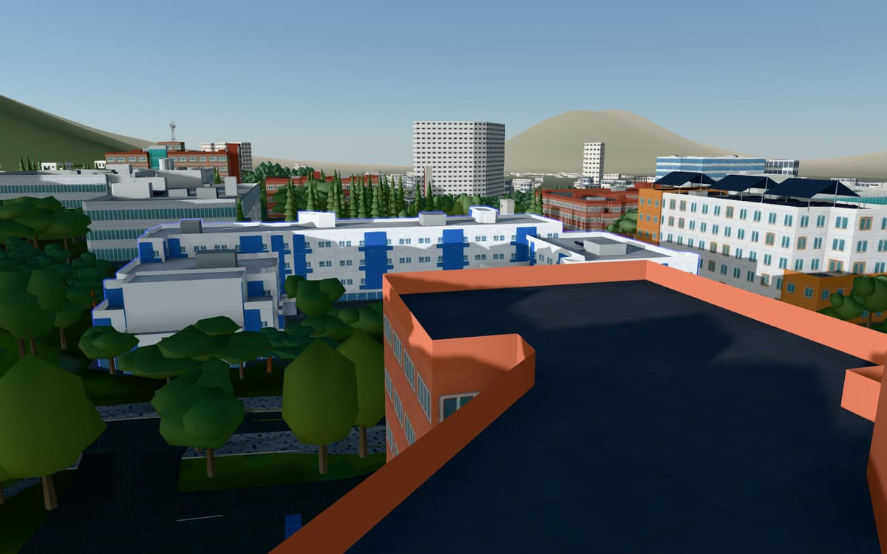

<div align="center">

# SCNU Digital Twin

국립순천대학교 캠퍼스 3D 모델 위에 기상, 교통, 에너지 데이터를 함께 표시하는 디지털 트윈 대시보드


</div>

## 소개

시각을 정하면 그 시각의 건물 그림자 범위가 지도에 나타납니다. 정체 구간과 옥상 태양광의 하루 발전량도 같은 화면에서 확인합니다. 캠퍼스 모델은 공개 지리 데이터와 항공사진을 입력으로 스크립트가 생성하며, 사람이 직접 모델링한 부분은 없습니다.

저장소는 세 부분으로 이루어져 있습니다.

1. **캠퍼스 모델 생성기** `frontend/scripts/campus-model/`
   지형, 건물 29동, 도로와 인도, 연석, 차선, 횡단보도, 수목 2,650그루, 가로등을 생성합니다. 출력은 `frontend/public/campus-v2.glb` 한 파일이며 용량 19 MB, 삼각형 수는 약 100만 개입니다.
2. **대시보드** `frontend/`
   제품은 Three.js로 렌더링하는 Main입니다. 로그인한 계정의 역할이 학생이면 학생 화면을, 관리자면 관리자 대시보드를 엽니다. VWorld 지도 기반 엔트리는 기능 개발을 중단했고 빌드 통과만 유지합니다.
3. **Python 백엔드**
   `weather/`는 기상청과 에어코리아 자료로 건물별 미기후를 추정합니다. `backend/simulation/`은 보행자와 차량을 분리한 교통 시뮬레이션을 실행하고, `vision_api.py`는 정문 카메라 영상에서 차량 수를 집계합니다.

건물 높이, 재질, 일사량, 전력 수요처럼 화면에 표시하는 값 중 다수는 계측값이 아닌 추정값입니다. 그런 값에는 화면마다 `추정` 표시가 있습니다. 데이터별 출처와 사용 조건은 [`docs/data-licences.md`](docs/data-licences.md)에 기록되어 있습니다.

<table>
<tr>
<td width="50%"></td>
<td width="50%"></td>
</tr>
<tr>
<td align="center"><sub>공과대학 3호관(D4)은 층과 호실 단위까지 내부를 탐색합니다.</sub></td>
<td align="center"><sub>오후 5시의 학생회관 앞 광장입니다. 시각 슬라이더를 움직이면 태양 위치와 그림자가 함께 바뀝니다.</sub></td>
</tr>
</table>

## 디렉터리와 포트

| 경로 | 역할 | 포트 |
|---|---|---|
| `frontend/` | Main 대시보드, 동결된 VWorld 엔트리, 캠퍼스 모델 생성기 | 5173 |
| `weather/` | 기상, 미기후, 태양광 에너지 API | 8000 |
| `vision_api.py` | 대시보드에 차량 계수를 제공하는 YOLO 엔드포인트 | 8001 |
| `car_vision_model/` | 대시보드와 독립된 차량 인식 데모 | 8003 |
| `backend/simulation/` | 교통 시뮬레이션 API와 WebSocket | 8002 |
| `backend/harness/` | AI 도우미 하네스. 계정마다 세션을 분리하고 Timely를 거쳐 Claude Sonnet 5.5를 호출합니다 | 8004 |
| `backend/twin_mcp/` | 하네스가 트윈 데이터를 조회하는 MCP 서버 | 없음 |
| `common/data/` | 건물, 도로, 교차로의 ID와 지오메트리. 모든 서비스가 동일한 `BLD_*` ID를 사용합니다 | 없음 |
| `common/campus_auth.py` | 계정과 로그인 토큰 처리. 기상 API와 교통 시뮬레이션 API가 공유합니다 | 없음 |
| `TrafficSafety/` | 안전 신고 OCR/NLP 실험용 Streamlit 앱으로, 대시보드와 별도로 실행합니다 | 없음 |
| `docs/` | 정적 데모 페이지, 테스트 증빙 자료, 데이터 라이선스 기록 | 없음 |

하위 디렉터리에도 각각 `README.md` 또는 `AGENTS.md`가 있습니다. 모델 생성기를 수정할 때는 [`frontend/scripts/campus-model/README.md`](frontend/scripts/campus-model/README.md)를, 교통망을 수정할 때는 [`backend/simulation/README.md`](backend/simulation/README.md)를 먼저 확인하세요.

## 로컬 실행

필요한 도구는 Python 3.11 이상과 bun 1.1 이상입니다. 녹화 영상을 비전 입력으로 사용할 때는 ffmpeg도 설치합니다. 모든 명령은 저장소 루트에서 실행하고, 가상환경을 활성화하는 대신 `.venv` 안의 인터프리터 경로를 직접 호출합니다.

### 1. 의존성 설치와 환경 파일

macOS, Linux:

```bash
python3 -m venv .venv
.venv/bin/python -m pip install \
  -r weather/requirements.txt \
  -r backend/simulation/requirements.txt \
  -r car_vision_model/requirements_server.txt
bun install --cwd frontend
cp weather/.env.example weather/.env
cp frontend/.env.example frontend/.env
```

Windows PowerShell:

```powershell
py -m venv .venv
.venv\Scripts\python.exe -m pip install `
  -r weather\requirements.txt `
  -r backend\simulation\requirements.txt `
  -r car_vision_model\requirements_server.txt
bun install --cwd frontend
cp weather\.env.example weather\.env
cp frontend\.env.example frontend\.env
```

복사한 환경 파일에 값을 채웁니다. API 키는 커밋하지 마세요.

- `weather/.env`에는 기상청(KMA) 키와 에어코리아 키를 넣습니다.
- `frontend/.env`에는 `VITE_API_URL`, `VITE_VISION_API_URL`, `VITE_SIMULATION_API_URL`, `VITE_SIMULATION_WS_URL`을 설정합니다. `VITE_VWORLD_API_KEY`는 VWorld 엔트리를 실행할 때만 필요합니다.

### 2. 서비스 실행

서비스마다 터미널을 하나씩 열어 실행합니다. Windows에서는 `.venv/bin/python`을 `.venv\Scripts\python.exe`로, `/`를 `\`로 바꾸면 같은 명령이 됩니다.

```bash
# 기상 API (8000)
.venv/bin/python -m uvicorn api.app:app --app-dir weather --host 127.0.0.1 --port 8000
# 교통 시뮬레이션 API (8002)
.venv/bin/python -m uvicorn simulation.main:app --app-dir backend --host 127.0.0.1 --port 8002
# AI 도우미 하네스 (8004)
.venv/bin/python -m uvicorn harness.main:app --app-dir backend --host 127.0.0.1 --port 8004
# 비전 API (8001). YOLO 가중치와 카메라가 준비된 경우에만 실행
.venv/bin/python vision_api.py --source 0 --port 8001
# 프런트엔드 (5173)
bun run --cwd frontend dev:main
```

| 서비스 | 상태 확인 주소 | 참고 |
|---|---|---|
| 기상 API | `http://127.0.0.1:8000/health` | Swagger 문서는 `/docs` |
| 비전 API | `http://127.0.0.1:8001/api/traffic` | `--source`에는 카메라 번호, 영상 파일 경로, 스트림 URL을 지정합니다 |
| 교통 시뮬레이션 | `http://127.0.0.1:8002/health` | 교통망 재생성은 `bun run --cwd frontend network:build` |
| Main 대시보드 | `http://127.0.0.1:5173` | |
| VWorld 대시보드 | `http://127.0.0.1:5173/index-vworld.html` | `bun run --cwd frontend dev:vworld`로 실행 |

AI 도우미는 `TIMELY_API_KEY` 환경변수가 설정되어 있어야 응답합니다. 이 키는 셸 환경변수로만 전달하고 파일이나 `.env`에는 저장하지 마세요. 하네스를 실행하려면 `pip install -r backend/harness/requirements.txt`로 `mcp` 패키지를 추가 설치해야 합니다. 세부 설정은 [`backend/harness/AGENTS.md`](backend/harness/AGENTS.md)에 있습니다.

YOLO 가중치는 gitignore 대상이라 저장소에 포함되어 있지 않습니다. 별도로 내려받은 뒤 `--model <경로>`로 지정하세요. 첫 실행은 모델을 읽고 카메라를 여는 시간 때문에 느립니다.

### 3. 로그인

`http://127.0.0.1:5173`에 접속하면 로그인 화면부터 나타납니다.

- `게스트 · 학생 모드` 버튼은 학생 화면을 엽니다.
- `게스트 · 관리자 모드` 버튼은 모든 기능을 갖춘 관리자 대시보드를 엽니다.
- 시제품 계정으로도 로그인합니다. 학생은 `20239901`, 관리자는 `admin`이고 비밀번호는 모두 `12341234`입니다. 비밀번호는 정확히 8자리여야 합니다.

조회 요청에는 인증이 필요 없습니다. 설치 계획 저장이나 시뮬레이션 제어처럼 데이터를 바꾸는 요청은 서버가 관리자 토큰을 검사합니다. 외부에 배포하기 전에는 `SCNU_AUTH_GUEST_ENABLED=0`으로 게스트 로그인을 비활성화하고 `common/campus_auth.py`의 계정 목록을 교체하세요.

기상 API를 실행하지 않아도 게스트 버튼으로 들어가 지도 탐색과 건물 선택을 사용합니다. 이 경우 패널의 날씨 항목에는 "기상 갱신 없음"이 표시됩니다.

### 카메라 조작

Main과 VWorld 대시보드의 조작 방식은 같습니다. 구현은 `frontend/src/camera/cameraGestures.mjs`에 있습니다.

| 입력 장치 | 확대·축소 | 회전 | 기울이기 | 이동 |
|---|---|---|---|---|
| 트랙패드 | 핀치 | 두 손가락 가로 쓸기 | Option(Alt) + 두 손가락 세로 쓸기 | |
| 터치스크린 | 두 손가락 핀치 | 한 손가락 끌기 또는 두 손가락 비틀기 | | 두 손가락 끌기 |

## 테스트와 빌드

| 작업 | 명령 |
|---|---|
| 프런트엔드 테스트 | `bun run --cwd frontend test` |
| Python 테스트 | `.venv/bin/python -m pytest` |
| Main 빌드 | `bun run --cwd frontend build` |
| VWorld 빌드 | `bun run --cwd frontend build:vworld` |
| 캠퍼스 GLB 재생성 | `bun run --cwd frontend model:build` |
| 건물 AO 베이크 | `bun frontend/scripts/campus-model/bake/bake-ao.mjs` |
| 지면 AO 베이크 | 위 명령에 `--planar` 추가 |
| 보행·차량 교통망 재생성 | `bun run --cwd frontend network:build` |
| 이전 모델과 비교 | 대시보드 주소에 `?model=uni` 추가 |

`bun run --cwd frontend test` 한 번으로 node 단위 테스트, vitest, 정적 검사를 모두 실행합니다. Main과 VWorld 빌드는 둘 다 성공해야 합니다. 생성기를 수정했다면 `model:build`로 만든 GLB를 함께 커밋하고, 지오메트리가 바뀐 경우에는 AO도 다시 베이크합니다.

## 다른 포트로 실행

백엔드는 `--port` 값만 바꿉니다. 프런트엔드에는 변경한 포트를 가리키는 `VITE_*` 변수를 넘기고 Vite 포트는 `--port`로 지정합니다.

```bash
export VITE_API_URL=http://127.0.0.1:18000
export VITE_VISION_API_URL=http://127.0.0.1:18001
export VITE_SIMULATION_API_URL=http://127.0.0.1:18002
export VITE_SIMULATION_WS_URL=ws://127.0.0.1:18002/ws/simulation
cd frontend && bun run dev:main -- --port 15173
```

```powershell
$env:VITE_API_URL = "http://127.0.0.1:18000"
$env:VITE_VISION_API_URL = "http://127.0.0.1:18001"
$env:VITE_SIMULATION_API_URL = "http://127.0.0.1:18002"
$env:VITE_SIMULATION_WS_URL = "ws://127.0.0.1:18002/ws/simulation"
cd frontend; bun run dev:main -- --port 15173
```

## 휴대폰으로 접속

PC와 휴대폰을 같은 Wi-Fi에 연결합니다. 백엔드는 `--host 0.0.0.0`으로 실행하고, 프런트엔드의 API 주소는 PC의 LAN IP로 지정합니다. 아래 `<LAN IP>`를 `192.168.0.10` 같은 실제 PC 주소로 바꾸세요.

```bash
.venv/bin/python -m uvicorn api.app:app --app-dir weather --host 0.0.0.0 --port 8000
.venv/bin/python -m uvicorn simulation.main:app --app-dir backend --host 0.0.0.0 --port 8002
export VITE_API_URL="http://<LAN IP>:8000"
export VITE_VISION_API_URL="http://<LAN IP>:8001"
export VITE_SIMULATION_API_URL="http://<LAN IP>:8002"
export VITE_SIMULATION_WS_URL="ws://<LAN IP>:8002/ws/simulation"
cd frontend && bun run dev:main -- --host 0.0.0.0
```

```powershell
.venv\Scripts\python.exe -m uvicorn api.app:app --app-dir weather --host 0.0.0.0 --port 8000
.venv\Scripts\python.exe -m uvicorn simulation.main:app --app-dir backend --host 0.0.0.0 --port 8002
$env:VITE_API_URL = "http://<LAN IP>:8000"
$env:VITE_VISION_API_URL = "http://<LAN IP>:8001"
$env:VITE_SIMULATION_API_URL = "http://<LAN IP>:8002"
$env:VITE_SIMULATION_WS_URL = "ws://<LAN IP>:8002/ws/simulation"
cd frontend; bun run dev:main -- --host 0.0.0.0
```

비전 API는 기본 호스트가 이미 `0.0.0.0`이므로 옵션을 바꿀 필요가 없습니다. 휴대폰 브라우저에서 `http://<LAN IP>:5173`으로 접속하세요. VWorld 엔트리는 API 키에 해당 LAN IP가 호스트로 등록되어 있지 않으면 지도 인증에 실패하므로, 등록하지 않았다면 Main으로 확인합니다.

## 문제 해결

**날씨 패널이 늦게 뜨거나 비어 있음.** 기상청이나 에어코리아 응답이 지연되거나 실패한 상황입니다. 캐시된 이전 응답이 있으면 그 값을 표시하고, 없으면 API가 503과 안내 메시지를 반환합니다. 지도와 건물 팝업은 영향을 받지 않습니다.

**VWorld 지도가 표시되지 않음.** `frontend/.env`의 `VITE_VWORLD_API_KEY`가 비어 있거나 접속한 호스트가 키에 등록되지 않았는지 확인하세요.

**비전 API가 모델 파일을 찾지 못함.** 저장소에는 YOLO 가중치가 없습니다. 파일을 내려받아 `--model`로 경로를 지정하세요.

**포트 충돌.** `car_vision_model/` 데모는 8003 포트를 사용합니다. 대시보드용 비전 API의 8001 포트와 겹치지 않게 실행하세요.

## 협업 규칙

기본 브랜치는 `dev`이고, `main`은 배포 가능한 소스만 받습니다.

1. 최신 `dev`에서 `feature/<작업명>` 브랜치를 만듭니다.
2. 커밋 메시지는 `fix:`, `feat:`, `build:` 같은 접두어로 시작하고 변경 내용과 이유를 한국어로 씁니다.
3. 푸시 전에 테스트를 실행합니다. 모델을 수정했다면 GLB도 재생성합니다.
4. `dev`를 대상으로 PR을 열고, 리뷰를 마치면 머지한 뒤 브랜치를 삭제합니다.

```bash
git checkout dev && git pull origin dev
git checkout -b feature/<작업명>
# 작업과 커밋
git push -u origin feature/<작업명>
```

여러 사람이 같은 파일을 동시에 수정하면 충돌이 생기므로 작업은 컴포넌트나 모듈 단위로 나눕니다. 작업 기간이 길어지면 원격 `dev`를 작업 브랜치에 수시로 병합하고, 충돌은 PR을 열기 전에 로컬에서 해결하세요.

VWorld 엔트리는 기능 추가와 QA 대상에서 제외되어 있습니다. 다만 패널이나 데이터 흐름처럼 두 엔트리가 공유하는 코드를 바꿨다면 `build:vworld`가 성공하는지 확인해야 합니다. 저장소는 현재 비공개지만 사업단 증빙을 위해 공개할 가능성이 있으므로 민감한 값은 처음부터 저장소에 넣지 않습니다.

---

<details>
<summary><b>태양광과 에너지 개발 환경</b>: SQLite seed와 reset, 계산 가정, 수동 확인 절차</summary>

### 실행별 개발 데이터베이스

실행할 때마다 새 SQLite 파일을 지정합니다. FastAPI는 파일에 처음 접근할 때 스키마와 결정적 캠퍼스 seed를 생성합니다. seed에는 D1-D4, C1, 옥상, 시간표, 기본 설치 시나리오가 들어 있습니다. 아래 예시는 Windows PowerShell 기준입니다.

```powershell
$RunId = [guid]::NewGuid().ToString('N')
$EnergyDbParent = (Join-Path $env:TEMP "campus-energy-$RunId")
New-Item -ItemType Directory -Path $EnergyDbParent -ErrorAction Stop | Out-Null
$EnergyDbPath = (Join-Path $EnergyDbParent 'energy.sqlite3')
$env:WEATHER_ENERGY_DB = $EnergyDbPath
.venv\Scripts\python.exe -m uvicorn api.app:app --app-dir weather --host 127.0.0.1 --port 8000
```

다른 PowerShell 창에서 Vite를 실행합니다. 프런트엔드는 별도 설정이 없으면 `http://127.0.0.1:8000`의 FastAPI에 연결합니다.

```powershell
cd frontend; bun run dev:main -- --host 127.0.0.1 --port 5173 --strictPort
```

### seed, reset, 시나리오 삭제

**seed**는 기존 데이터를 지우지 않습니다. `WEATHER_ENERGY_DB` 경로의 파일에 없는 스키마와 내장 fixture만 추가합니다. `INSERT OR IGNORE`로 삽입하기 때문에 사용자가 만든 시나리오, 배열, 계산 결과는 그대로 유지됩니다.

```powershell
.venv\Scripts\python.exe -c "from weather.energy.persistence import Database; import os; Database(os.environ['WEATHER_ENERGY_DB']).initialize(); print(os.environ['WEATHER_ENERGY_DB'])"
```

**reset**도 파일을 삭제하는 방식이 아닙니다. 새 고유 경로를 `WEATHER_ENERGY_DB`로 지정한 다음 위의 seed 명령을 다시 실행합니다. 이전 데이터베이스와 시나리오는 원래 경로에 보존됩니다.

```powershell
$EnergyDbParent = (Join-Path $env:TEMP ("campus-energy-{0}" -f [guid]::NewGuid().ToString('N')))
New-Item -ItemType Directory -Path $EnergyDbParent -ErrorAction Stop | Out-Null
$EnergyDbPath = (Join-Path $EnergyDbParent 'energy.sqlite3')
$env:WEATHER_ENERGY_DB = $EnergyDbPath
.venv\Scripts\python.exe -c "from weather.energy.persistence import Database; import os; Database(os.environ['WEATHER_ENERGY_DB']).initialize(); print(os.environ['WEATHER_ENERGY_DB'])"
```

**시나리오 삭제**는 실행 중인 API에 정확한 시나리오 ID를 지정해서 한 건씩만 요청합니다. 와일드카드 삭제나 전체 초기화 명령은 제공하지 않습니다.

```powershell
Invoke-WebRequest -Method Delete -Uri 'http://127.0.0.1:8000/energy/scenarios/EXACT_SCENARIO_ID'
```

데이터베이스 파일을 직접 삭제하거나 공유 DB를 초기화하지 마세요. 개발이나 QA를 마치고 파일을 정리할 때는 본인이 생성한 고유 경로인지 먼저 확인합니다.

### 계산 가정

모든 소비량은 15분 간격의 가상 예측값이며 계측값이 아닙니다. 기상 preset 역시 시나리오용 추정치이고, 공학적으로 보정한 값으로 취급하지 않습니다.

| 항목 | 값 |
|---|---|
| 기본 대기 부하 | 강의실 0.20 kW, 컴퓨터실 0.80 kW, 실험실 1.00 kW, 교수실 0.40 kW, 서버실 6.00 kW |
| 점유 시 조명 | 소형 0.60 kW, 중형 1.00 kW, 대형 1.50 kW |
| 일반 plug 부하 | 강의실 0.40 kW, 컴퓨터실 0.80 kW, 실험실 2.00 kW, 교수실 0.80 kW |
| 기기별 부하 | 컴퓨터 0.15 kW/대, 대형 화면 0.30 kW, 점유 HVAC 2.50 kW/대, 서버 HVAC 상시 1.25 kW/대 |
| 태양광 모듈 | 1.05 m x 2.10 m, 효율 20%, 정격 441 Wp, 패널 간격 0.02 m |
| 이격 거리 | 옥상 가장자리 0.50 m, 장애물 1.00 m |
| 절감 단가 | 기본 160 KRW/kWh |

발전량은 `용량(kWp) x 경사면 일사량(kWh/m2) x 온도계수 x (1 - 시스템손실) x 음영계수`로 구합니다. 시스템 손실 기본값은 10%이며 곱하는 계수는 각각 0..1 범위로 제한합니다.

나머지 지표는 다음 식으로 계산합니다.

- 직접사용량 `min(발전, 수요)`
- 계통수전 `max(수요 - 발전, 0)`
- 잉여 `max(발전 - 수요, 0)`
- 자급률 `직접사용 / 수요`
- 태양광 활용률 `직접사용 / 발전`

일 단위와 월 단위 비율은 구간별 비율을 평균하지 않고 에너지 합계로 계산합니다. 비용과 탄소 결과는 화면이나 API에 설정 가능한(configurable) 가정이 명시된 경우에만 계산값으로 해석하며, 계측값으로 간주하지 않습니다. 캠퍼스 순위는 날짜와 결정적 기상 preset이 같은 결과끼리만 비교합니다. 순위 산정에는 365일 연환산, 1800 kWh/kWp 기준, 화면에 표시된 가중치를 사용합니다.

### 수동 확인 절차

1. 새 고유 DB 경로로 FastAPI와 Vite를 실행하고 `/health`가 `{"status":"ok"}`를 반환하는지 확인합니다.
2. 우측 패널의 `에너지` 탭을 열어 `건물별 태양광 추천` 목록과 완료, 불완전, 시나리오 없음 상태가 표시되는지 봅니다.
3. `D4 공과대학 3호관 상세 보기`에서 `태양광 설치`를 선택합니다. 안내 카드에 옥상 로컬 좌표(m), 배열 drag 방법, 회색 장애물 설명이 나오는지 확인합니다.
4. 배열을 2행 x 8열, 방위각 180도, 경사각 25도로 설정해 저장합니다. `다시 불러오기`를 누른 뒤에도 값이 같아야 합니다.
5. 배열을 옥상 밖이나 계단실 위로 끌어 봅니다. 빨간 preview와 한국어로 된 제약 사유가 나타나고 저장 버튼이 비활성화되어야 합니다. `Esc`를 누르면 마지막으로 유효했던 배치로 복귀합니다.
6. 캠퍼스 지도로 나와 `에너지` 탭을 확인합니다. 수요는 `가상 예측`, 일사량은 `시나리오/추정`으로 표시되어야 하고, 15분 구간 96개 chart, KPI, 손실 항목, 공간 유형별 수요가 보여야 합니다.
7. 같은 날짜와 맑음 조건으로 캠퍼스 비교를 실행합니다. D1, D2, D3, D4는 점수 구성요소와 함께 순위에 오르고, C1은 옥상 메타데이터 누락 사유와 함께 제외되어야 합니다. 순위 카드의 `배치 편집`은 해당 건물 옥상을 열고, `1위 추천을 새 시나리오로 열기`는 원본과 분리된 편집용 복사본을 생성합니다.
8. API를 중지하거나 브라우저에서 `/energy/**` 요청을 차단해 장애 복구를 점검합니다. dashboard와 comparison 화면은 오류 메시지와 `다시 시도` 버튼을 표시해야 하고, 0 같은 임의 값을 채우지 않으며, 편집 중인 배치를 보존해야 합니다. API를 다시 띄운 뒤 재시도하면 정상 응답해야 합니다.
9. 1440x900과 390x844 해상도에서 가로 스크롤 넘침, 잘린 한국어 문구, 서로 겹친 편집 controls가 없는지 확인합니다.

API를 직접 점검하려면 `POST /energy/scenarios`로 시나리오를 만들고, 응답의 `id`로 `POST /energy/scenarios/{id}/simulate`를 호출합니다. 요청 본문 예시는 Swagger `/docs`의 `ScenarioCreate`와 `DateRequest` 스키마에 있습니다.

</details>
